# twopointsix

A 2.5D top-down stealth **tech demo** in the spirit of Splinter Cell: Chaos Theory, running on WebGPU.
Box-only geometry, diffuse-only materials, and every photon is dynamic: guards' flashlights, muzzle flashes,
switchable ceiling panels, monitors, street light through the windows, moonlight — all ray traced against the
scene every frame, plus a real-time Eulerian smoke solver for gun smoke and smoke canisters.


| | |
|---|---|
| 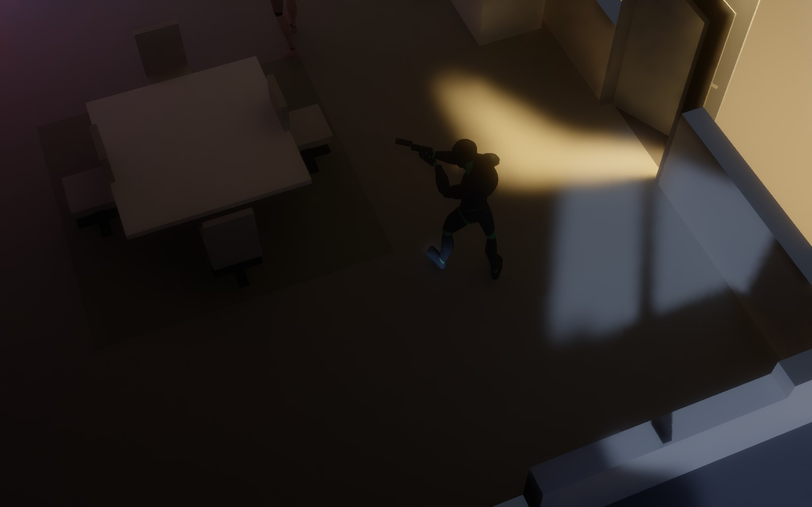 | 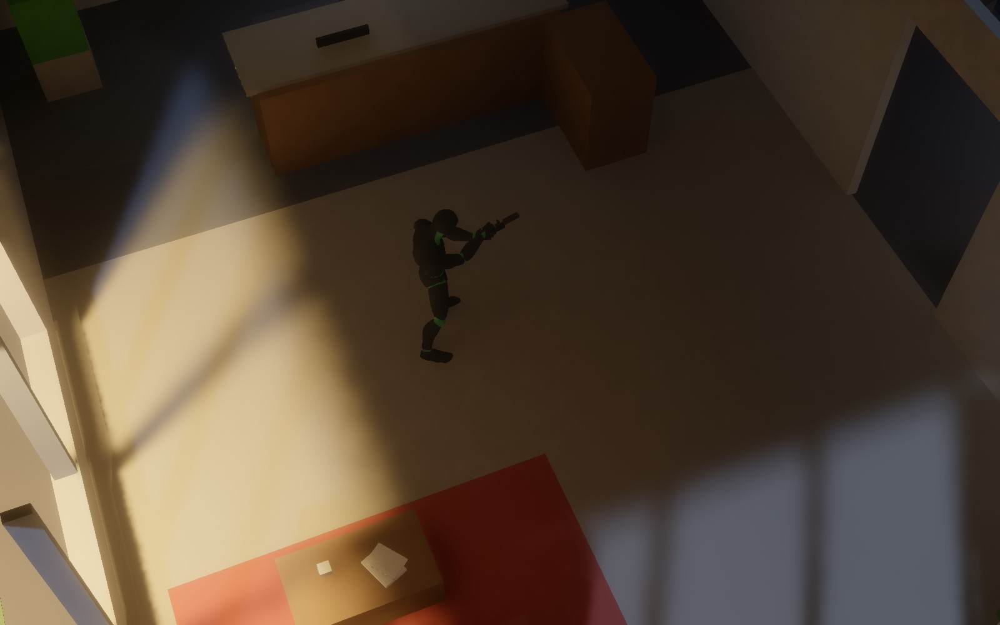 |
|  |  |
| 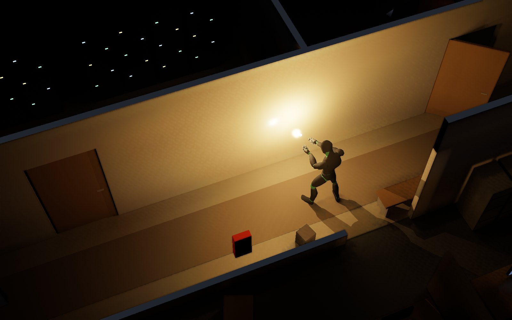 | 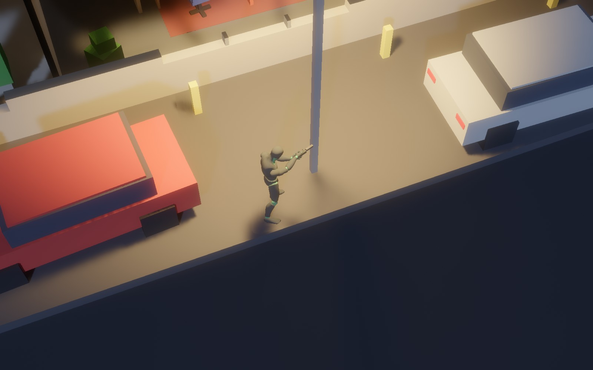 |
| 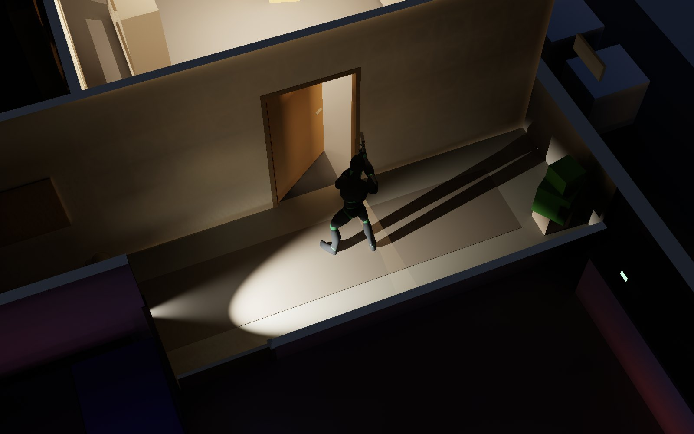 |  |
| 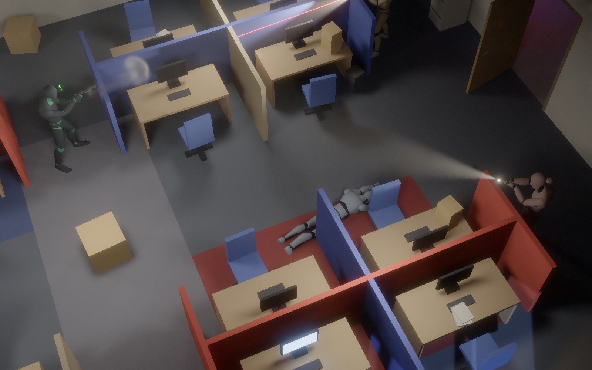 | 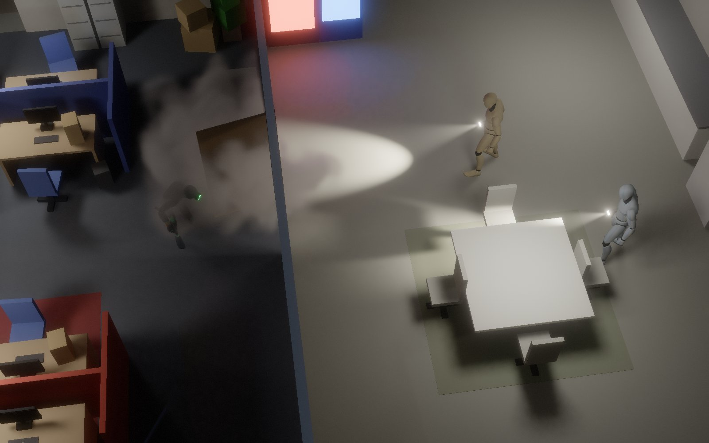 |
| 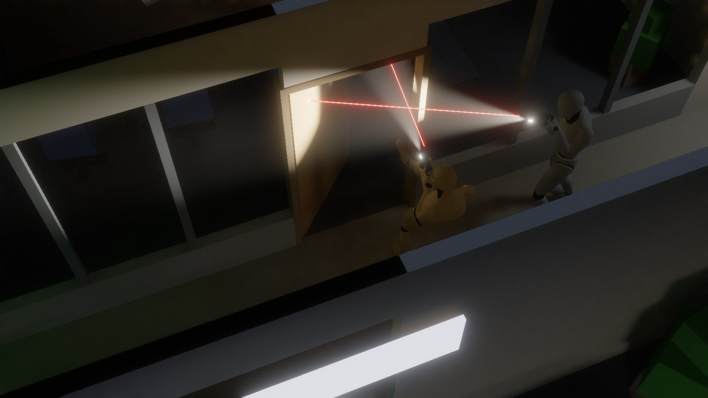 | 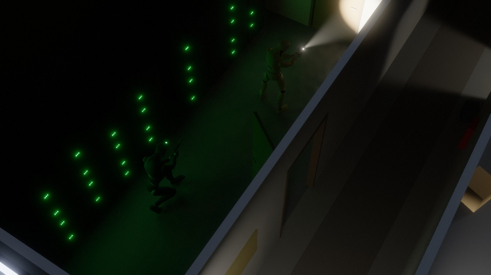 |
| 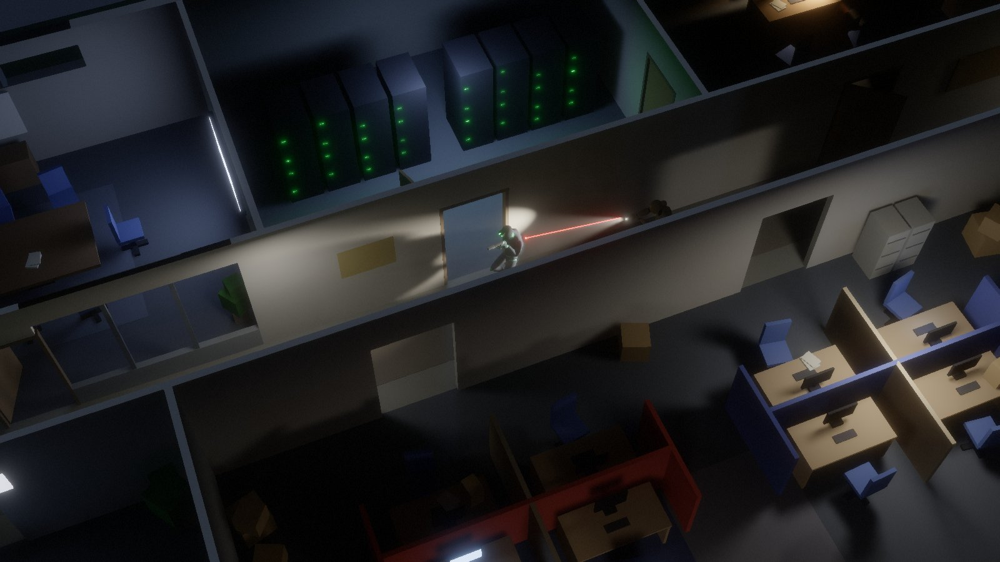 | 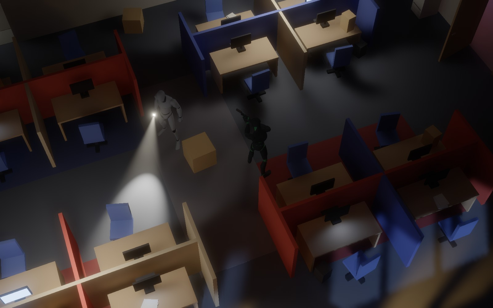 |

<sub>Captured headlessly through the engine's own readback (`__shot()` + `bun run tools/shot-server.ts`), no HUD.</sub>

## Aug 12 — a night people work in, air that moves, paper that flies, and a renderer with every tier gated

The floor is no longer only guards. **Marta cleans the cubicles and Owen works late** — civilians who see and hear through the guards'
own model, startle, run for the nearest calm man or a wall phone, and count in the debrief; hold one and the shift treats it as a hostage
situation. Bodies are found by the light on them (or the finder's torch), not by range. **Checkpoints** autosave on quiet stage changes
and the down card offers the newest one. **Destruction under sustained fire**: paper stacks turn into lit two-sided sheet particles,
dust goes into the real smoke solver (so it dims a torch beam and a guard's sight line alike), monitors die with their light, ceiling
tiles come down, and a stun grenade in a papered room lifts every leaf within two metres — all capped per frame behind one `chaos`
knob whose zero is the old game byte for byte. **Wind** is one analytic field: six ceiling vents from the level file, the storm, gusts
through open exterior doors, pushing particles and forcing the smoke solver together; moths gather under the lit street lamps and
moths circle the sodium lamp. Smoke stops at a shut door now and floods through when it opens.

The **workbench** (`/workbench`) houses the level editor and the character viewer on one engine: a Materials mode with live
albedo / roughness / metal editing and a pixel-grid **markings** painter (palette-indexed bitmaps on box faces on one world lattice,
no gradients, no baked light; emissive fronts register as real rect lights), staging scenes that stand a walking guard in the level
from any mode. First load no longer freezes the browser: the ~100 boot pipelines compile asynchronously behind a card that is up in
80 ms.

**Renderer v3** is complete and every quality tier passes its frame-time gate on the reference GPU (high holds a QRF firefight in
the rain under 14 ms at p95, ultra under 30, the lower tiers run the same pipeline scaled): temporal upscaling with per-object motion
vectors, ReSTIR direct lighting with a **hybrid path for lights people carry** (torches, gun lights and muzzle flashes take a few
stratified emitter samples from the pixel's own point every frame, so a sweeping torch is as clean as the old estimator), froxel
volumetrics, one shared shadow / indirect / specular denoiser, per-finish materials with ray-traced reflections and an analytic
detail layer, sharp direct light evaluated at output resolution, round-cone character proxies fitted to the mesh, and a quality
ladder that climbs on measured headroom as well as cutting under load.

## Aug 9 — a storm outside, glass you can put a round into, and everything you hit shows it

Four renderer experiments came in together. **It rains**: streaks drawn in the outdoor air by the volumetric pass and lit by whatever
light is there, splash rings on a wet, mirroring car park, and every so often **lightning** — one transient sun for a fifth of a
second, so every window frame prints across the floor through the ordinary direct pass — with the thunder rolling in later by the
distance (Tab ▸ Weather; `?noweather`). **The glazing is glass**: the conference partition, the manager's sidelight and every exterior
window tint what is behind them, mirror the room at a glancing angle and catch a torch on their grime; guards see you through it
and cannot hear you through it. It is laminated, so a round *stops* in the pane and **stars it** — a hole, a milky collar and a web
of cracks drawn on the glass where it hit, a different star every time, the crack heard down the corridor — and the pane holds
(`?noglass`). **Marks**: bullet holes with chipped rims wherever rounds stop, the scorch of a stun charge with splashes up the
furniture, boot scuffs on kicked doors that ride the leaf, chips where a ring airfoil clacks (`?nodecals`). **GPU particles**:
sparks off steel that cool as they skitter, plaster chips and dust that lie where they land and read the light there, and spent
brass trundling out of the FN2000 (`?noparticles`). All four are on by default and each has its Tab section.
And whoever stands in that rain now **gets wet**: a few seconds under the open sky and the cloth goes dark and saturated under a
film of water that streams down in streaks and glints hard under a torch or a lightning stroke, drops beading and running down him;
back indoors he drips, leaves a trail of wet footprints, and dries out over half a minute (Tab ▸ Weather ▸ wet; `__wet`).

## Aug 9 — go loud and the response team comes up the stairs

**Clearing the floor with the rifle now brings company.** Once the floor is locked down *and* the shift has actually
heard your gunfire — a report at gunfire level in a living guard's ears (the FN2000, suppressed or not; the pistol's
cough never counts) — or has walked onto two of its men down, somebody radios control for the response team and the
whole telegraph plays on the net you already read: control's ETA, *thirty seconds*, *QRF on the stairs* (you can hear
the boots through the west stair door), then that steel fire door — the one Sam came in by, bolted to him from the
corridor and deaf to a boot — bangs open with four weapon lights behind it. They are ordinary guards on the shift's
side, moved as **one four-man element**: a file behind the point man with muzzles on the openings, the room holding
your last fix stacked on, opened, banged and flowed into by all four, called, held all round, then the next room by
walking distance; the moment one of them sees you the fight is the guards' own (bursts, muzzle discipline,
suppression, the standoff), and eight cold seconds later they re-form and go back to clearing. Carbines, a stun charge
each, steadier hands, short beats, and they never stand down — one wave a night, said so on the radio. Push it further
— kill one of them, put three men down, keep the gunfight running — and control **locks the compound down**: the lot's
lamps all come up and men take posts *outside* the exits with lights on the doors, so the fire exit is still the way
out but no longer a free one. Tab ▸ Sandbox has the switches (on/off, ETA, size, the perimeter tier) and test buttons.

## Aug 8 — hands on: grab a man, make him talk, and watch his friends work the problem

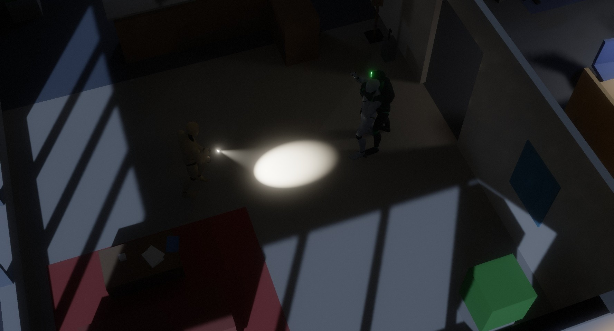

**Chaos Theory's controls, more or less.** Interactions arrive as a small list top-left of what is *near you*,
one row per thing you could do (a shut door is *push it open* and *ease it open — silent*; a lock is *pick* and
*kick*): tap `Space` for the highlighted row, hold it to open the list and scroll to another (let go to act, a
cancel row at the bottom); the pistol aims itself a little (the
reticle snaps to a light or a man's chest); `E` holsters or draws; the mouse wheel sets the walking pace; `Q`
presses your back to the wall beside you with a proper wall pose, standing or crouched, and a peek at the corner;
`Ctrl` + mouse orbits the camera. Near a guard who has not clocked you, the crouch-walk itself changes — slower
cadence, longer plants, lower hips, arms in — at the same ground speed. Guards, for their part, now see *motion*
far better than a still shape in the half-dark, keep their muzzles off each other, search the darkest measured
corners of a room first, and slice the pie through doorways instead of planting in them.

**The characters move better, too.** The walk and crouch cycles are retimed to their measured natural speeds (no more skating
a third of every stride), heads stay level and eyes forward instead of on the floor, bodies breathe and shift their weight at rest, a
stop carries the pelvis on and settles, and a man turned on the spot steps round instead of pivoting on his soles —
`bun run tools/qa/gait.ts` is the tape measure all of it was cut against. Pushing through a door — or easing one open from its row — now puts the free hand palm-flat on the leaf
(the gun hand keeps the pistol; holstered, whichever hand is on the door's free-edge side).

**Three late extras, each behind a toggle.** *Glossy floors* (pause ▸ Graphics trade-offs; off by default): the lobby stone and the lino
floors trace one jittered mirror ray per pixel through the same box scene the shadows use — vending-machine fronts, lit panels, a
passing torch and the blackout beacons turn up in the floor, Fresnel-weighted so they read as glints rather than a mirror, for about a
quarter of a millisecond. *The floor you walk on* (on; Tab ▸ Sandbox to A/B): one material map feeds the mixer, the guards' ears and the
sound meter alike — carpet muffles a walk to nothing at 2.5 m behind a calm man, the corridor lino gives you away in three seconds, the
lobby stone is louder still, and the meter says which you are on. *Attract mode*: leave the start card alone for a few seconds and the
camera starts cutting round the live level while the patrols walk their routes; touch anything and it is the plain card again.

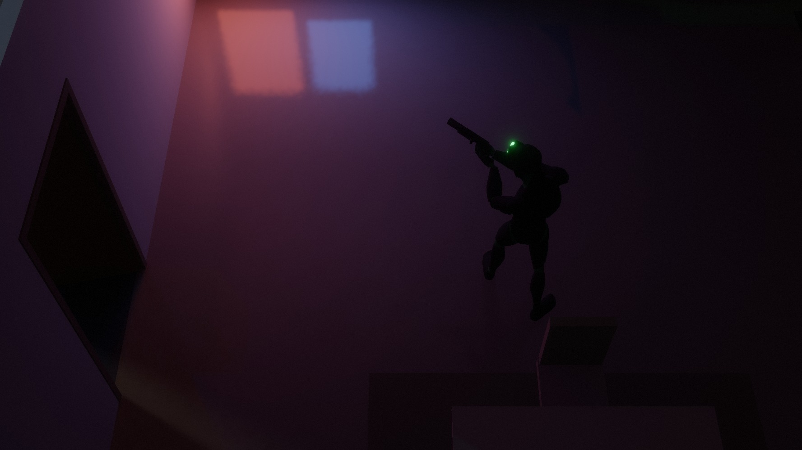

**And a second showcase, by day.** The start card's third button (or `?breach`) plays the same floor at ten in the
morning, Door Kickers rather than Splinter Cell: one directional sun raking in through the south glass — soft-edged
through the mullions by its angular size, marched through the room haze under the ceiling so the shafts show — every
fluorescent on, the street lamps and the moon out, and two operatives in Sam's colours running the long aisle to the
break room's side door with FN2000s at the low ready. It is battle drill six from there: they stack on the latch side,
the number two's fist comes up with the stun can in it — *set* — the point man steps out square, boots the leaf beside
its handle off his left leg and steps straight back to his own side of the frame; the can goes in round the jamb the
moment the latch edge clears, both look away, and on the bang the point man takes the fatal funnel — a stride and a
half straight in, muzzle across the middle, the man standing in it dropped with a controlled pair, then right into
his corner and along his wall — with the number two on his heels the other way, centre, his man, round the flung
leaf's tip into the machines' corner and squared to the corridor door: an L, the room and its next door owned, three
down. *Room clear* — and both close on that door and stack on it, the number two now the point. Cut; the veil, and the
night shift is back exactly as the start card always finds it. Thirty seconds, hands off, five fixed camera set-ups
cut on the drill's own cues, one line of caption on the letterbox. (The cast have sides, so the operatives' rounds
find the men inside through the ordinary ballistics — the drill only chooses whom and when; the men inside are still
pinned rather than fighting back, and `BREACH_STAGING.engage` in `src/game/breach.ts` is the seam a live engagement
plugs into. The guards' own two-man room clear keeps the same doctrine: off the funnel after the boot, centre then
corner, the number two on the room's other door.)

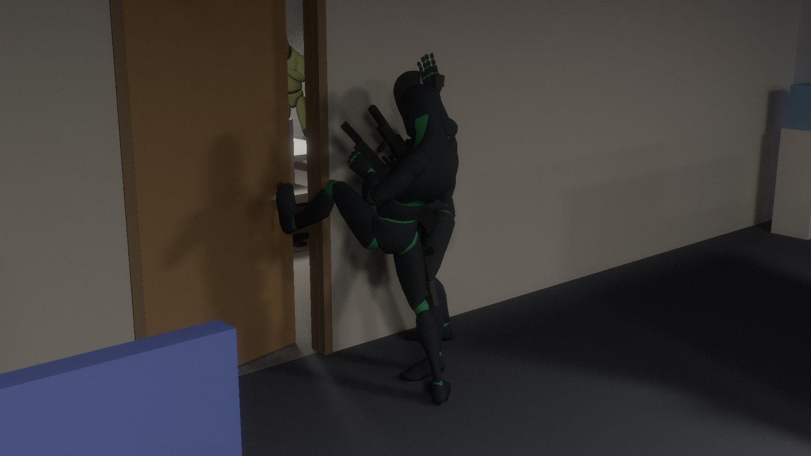

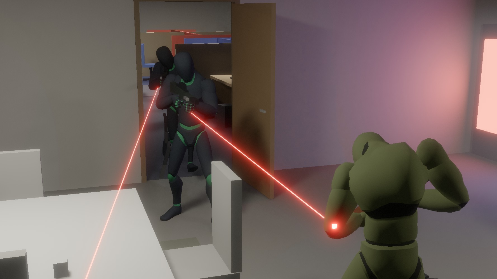


**Grab.** From behind, the one row `Space` offers takes the man — an arm across his
throat if your hands are empty, the Five-seveN along his temple if it is drawn. (The silent takedown is the other
hand now: holster with `E`, and a left click behind him drops him without a sound.) The pair moves as one
at a creep and gives to walls and door leaves as one; walk him into a door his key fits and it opens. He is deaf,
blind and off the radio net while you have him, which the next radio check will notice. His top row asks him a
question — Sam's own line goes up over Sam first (dry, short, worded for the moment: his first words as the arm
goes on, leaning on him, the pointed question when the man is about to give something up, the last word once he
has nothing left; the blade at his throat and the state of the floor colour it), and a beat later the man answers
**from what he actually perceived tonight** — a man who never knew you were there is
startled and knows nothing; one who watched you shoot his partner names it and hates you for it; what little he
gives up (his route, when the next check is due, which door on his beat is keyed) is only ever something he could
plausibly know — and when it is the keyed door ("we all carry one, mine's on my belt") Sam takes the key off him
there and then: a clack at his hip, a word from Sam as the man finishes, a small KEY tag in the kit column, and from
then on the locked doors open to Sam the way they open to the staff. Tap again while he is mid-answer and Sam cuts in with the next question.
Most holds now play as a **short scripted exchange with a shape** — dealt per man from his temperament, what he knows of
you and how rattled he is, and kept for the whole hold: the steady corridor man wants "how many of you" defined before
he will count (and the definition becomes the threat), or proves he really works here by naming the keyed door and
hearing himself do it; the nervy one folds before the question is finished and, pressed again, volunteers his locker
code and where the good biscuits are, or panics into an unstoppable stream about his parking appeal that Sam gives up
on (a dud, and Sam says so); the hard man gives two words of attitude, the fact through his teeth once rattled, and a
flat insult to close; a calm man will believe this is an unannounced security audit right up to the last press; Sam
sets a nonsense rule ("you don't say *basically*", "count down from seven") and it pays off at the end; or the threat
is simply the room they are standing in (the server room's fire gas, the break-room jug that has stewed since six, the
quarterly numbers on the conference-room whiteboard). Some answers get a third turn — Sam's rejoinder once the man's
line is down. A man who watched you hurt somebody gets none of this: he is frightened and says so. Sam's **handler**
has a voice on the radio strip at the job's beats (into the server room, the drive out, the rack noticed, the floor
going up, the lights dying, a body found) — her line, then his, dry, two lines and never during a fight — and two calm
guards who find themselves a few metres apart **stop and talk** for a line or four (the sensor in the gents that turns out
to be the air freshener, the thunk at midnight nobody has ever gone to look at, the PIN on a sticky note on the copier). The row under the question finishes it — a quiet choke-out with the arm, a quick loud pistol-whip with the gun (chosen, it runs on its own; a step or another tap and he breathes again),
both leaving him breathing (the men who find him say so, and the debrief counts knock-outs apart from kills) — there is no letting him go. His torch is knocked out of his hand at the grab and dies on the floor. With the gun at his
head a click fires past his ear at whatever the reticle has snapped to — and `E` swaps the two while you hold him: draw, and the knife goes away as the
Five-seveN comes up to his temple over a third of a second (fire past him, pistol-whip him; no questions over a gun); holster again and the blade is back
at his throat and he answers to it. The questions are the knife's.

**Sam has his FN2000.** Slot `2` brings the suppressed bullpup round off its sling and into his shoulder — it is
braced and aimed for as long as it is in his hands, rides diagonally across his back the rest of the time, magazine
behind the grip, and goes back there by itself for a grab, a takedown, a throw or the wall. To the floor it is the LOUD one: the suppressed Five-seveN reads as an odd
noise to a man within ~7 m (he comes to look; nobody calls a shot), while the FN2000 — a 5.56, suppressed or not — is gunfire
floor-wide. On the head he folds where he stands, out cold and
breathing, as quietly as a takedown from fifteen metres; in the body he doubles over, yelps, and comes up alert knowing
which side it came from; off a wall it is a clack the room goes to look at. The rings do not come back. It is always in the kit (`3` smoke, `4` stun after it).

**His colleagues do not just charge.** The first man to see the hold calls it in — *hold your fire, nobody push
him* — the floor locks down for a hostage, and they ring the pair at a few metres with weapons at low ready,
side-stepping round toward your back, two of them splitting sides, talking the while; cornered in a corridor with
no way round they hold and say so. They fire only on a clean line into your flank well clear of their man — turn
the pair to keep the shield toward them — and a round from in front finds the hostage first, which the shooter
knows at once. Drop the shield in front of them and they open up that instant.

## Aug 7 — a job to do, doors worth picking, guards who lock the floor down and clear rooms

The sandbox now has a point: **get into the server room, pull the drive from the marked rack, leave by the fire
exit.** One quiet line at the top of the screen says what is next, a small diamond marks it, holding **F** on
rack 6 spins its LEDs down over a few seconds (stay on it — sprinting off or dragging a body lets go), the rack and
its glow strips really drop off the emissive feed, and a few seconds later the nearest calm guard is radioed to go
and look at it. Step out through the fire exit and a **debrief card** rates the run from what the guards themselves
registered: a stealth score out of a hundred that only ever loses points — being *seen* is the expensive thing (more
so once the floor already knows), each alarm and each step the floor goes up costs, a body found costs, a kill costs
ten times a knockout, rounds put near men and lights shot out cost a little — read as a rating word (GHOST ≥ 90 ·
SHADOW ≥ 70 · OPERATIVE ≥ 40 · ASSAULT), a grid of the numbers, badges (*never seen*, *no alarms*, *no kills*,
*pacifist*, *lights out*, *talkative*, *locksmith*, *speedrun*), a **timeline** of the run stamped with the clock and
the room ('02:14 · corridor · heard: a door kicked in · Kowalski alerted'), and a **floor map** drawn from the nav grid
with Sam's path coloured by time and a pin for every sighting, alarm, knockout, kill, body found and light put out.
The same card comes up a beat after you go down, the pause menu's *Run so far* tab shows it mid-run, and *Copy summary*
puts the one-line version on the clipboard (`bun run tools/qa/probes.ts debrief` holds the timeline, the score's shape and the card).

**Doors have locks.** The server room, the breaker room and the manager's office are locked from the corridor side;
guards carry keys and the closers re-lock behind them (question a man until he gives the keyed door up and Sam
pockets his key: those doors then simply unlock for him on a tap, or ease open silently on a hold, and lock again
behind him). **Hold F** on a locked leaf and Sam plants beside the keyway,
crouched, gun holstered, and works the cylinder for about four and a half seconds with soft clicks that a man a few
metres off in a quiet corridor will half-hear (a ring round the reticle shows the progress; let go and it keeps for a
moment). **Tap F standing, or sprint into it,** and he kicks it in: the lock breaks at the kick's impact frame, the leaf
is flung to its stop, and the whole floor comes — a kicked door is as loud as a shot. Tap F crouched and he just tries
the handle.

**Going loud now costs something you can see.** When an alarm ends with nobody having laid eyes on you the floor
stays *heightened* for a while — patrols walk their routes with **pistols drawn and weapon lights on** instead of
torches, brisker, sharper-eyed — and a second alarm inside that window **locks it down**: the two nearest men pair
up (the follower trails his leader and inherits his suspicions), the third plants himself on the corridor junction
nearest the trouble, doors they pass get pulled shut and picked locks re-locked (a kicked one stays broken, and gets
remarked on), all of it called on the radio and stepped back down when the floor has been quiet long enough. Guards
also draw a visible **laser** while they hunt you, holster their sidearm on the thigh when calm, and speak in
**bubbles** over their heads.

The **showcase tour is thirteen stops** and two of the new ones are the systems above played straight: two guards
**clear the conference room** the way they were taught — stack on the door, the squeeze, a real kick, button-hook to
the corners, "checking under the table", "negative contact" — driven through a small squad-script layer over the same
guard code (procedural stack / high-ready / low-ready stances, the kick and the hand signals are new animation layers
on the mocap graph); and **the drive pull itself**, lit only by the racks' green wash, with the corridor man pushing
the door open to sweep the dead rack with his weapon light while Sam sits two metres off in the dark.

Under the hood: **auto quality now calibrates at boot** from a couple of seconds of GPU pass timings behind the start
card (fixed + per-pixel cost model → preset *and* resolution scale in one step, remembered per machine) instead of
crawling down while you suffer, and the pause menu grew a **Graphics — trade-offs** group of honest, measured
switches (a third-resolution bounce gather is the big one: 6.6 → 3.2 ms of a 24.5 ms frame on the reference machine,
hard to see; checkerboard shadow rays, quarter-resolution beams, half-rate bounce cache, fewer rays in near-black).
Three more renderer savings landed only after a pixel A/B said *identical*: per-tile light culling in the direct pass,
whole-tile pass-through in the penumbra filter, and empty-brick skipping in both the smoke solver and every smoke
sampler. The 1,400-line game module was split into mission / combat / guards / player / lighting / squad modules along the way.

## Aug 6 — ragdolls, takedowns, bigger smoke, proven-lossless renderer wins

Gameplay first: guards (and you) now die as **ragdolls** — a 16-particle position-based body with a shape-matched
trunk, stick and swing limits, colliding with the floor, the box grid and door leaves — so nobody folds into a wall
any more, and **dragging a body** pins its ankles to your hands while the rest trails and bumps round corners. Get
close behind a guard who has not clocked you and his marker offers a **silent takedown**. One **F** key now works
every marker (lights, doors, bodies, guards) — now a top-left panel of what is in reach; you go down in one shot like they do, and the
guards cover the body and radio it in instead of "searching" for you. There is a start card and an **Esc pause
menu** with friendly settings and the controls, Chaos-Theory-style **light and sound meters**, an **auto quality**
mode that picks and remembers the preset for the machine, canisters and magazines that tumble in flight, and the
showcase tour gained scripted beats driven through the real player: takedown + drag, a hull-down firefight (double taps into
cover, a stun charge over the top, a flank while they are blind), and a smoke canister screening a watched doorway — presented
with fades over the cuts, a letterbox and slow camera swings.

Renderer and fluid: a small **pixel-exact A/B harness** (`?paused` deterministic boots, lossless readback, image
diffs) let the parked optimisations land one at a time with a measured verdict — the two direct-light emitter
classes are denoised in one dispatch (≤4/255 on <0.03 % of pixels), leaders keep their scored irradiance (exact),
the smoke march shortlists the lights that can matter once per ray (exact) — and the smoke pressure solve moved
from 20 Jacobi sweeps to four red-black SOR pairs (27 → 15 dispatches a step, same plume). That headroom went into
**64³ smoke domains** (gun smoke in a 1.4 m cube, canisters in a ceiling-high 3.5 m cube), a canister worth three of
the old ones, and bore gas that visibly carries past the pistol.

## Lighting pipeline v2 (Aug 5, afternoon)

After a round of "GI blocky, torch shadows janky, direct harsh" and a look back at
[twopointfive](https://github.com/sujayakar/twopointfive) (the noisier path-traced predecessor), the frame was
rebuilt around three ideas: **one sampled estimator for all direct light** (every light is a finite emitter;
per pixel all lights are scored unshadowed, the leaders per emitter class get adaptive stratified shadow rays to
points on their emitters, the tail rides on their visibility, and a ratio-space à-trous filter driven by a PCSS
penumbra hint denoises visibility, never light — transients like muzzle flashes just work and leave nothing
behind), **a per-pixel traced final gather for
indirect** that reads the world-space probe volume only one bounce away (so its coarseness can't be seen: no
probe-scale blotches, real contact darkening, a torch's bounce comes off the exact spot it hits), and an
**HDR post chain** (bloom pyramid + AgX) instead of a clipping tonemap. It is faster than the build it replaces
(8.6–13.2 ms vs 16–17 ms at 1600×1000 on an M4 Max) and its cost no longer scales with the number of lights.
Details under *How the frame is built*.

## Aug 5 — capsule shadows, soft shadows, GI fixes

Playtest feedback first: character shadows are now analytic capsules (no more box-men), sized lights cast
soft shadows with a two-pass edge-aware denoise, the window/GI leaks and street-lamp banding are gone, indirect
light gets a reprojected temporal filter (direct light and beams never do), you cannot clip into walls, sprint is
CoD-style, the Five-seveN has magazines you actually manage, and there is night vision and a rail light.
Then the new toys: a proper kit HUD, thrown smoke canisters with an arc preview and rigid-body bounces, dense
configurable smoke that characters and bullets shove around and that blinds guards, a WebAudio layer where every
sound is synthesized and *propagated* through the level (around corners, through doorways, muffled by closed
doors — guards hear through the same model), a generative Amon-Tobin-ish score driven by the alert level,
physical doors that throw wedges of light as they swing, a mains breaker / blackout event with rotating emergency
beacons, set dressing everywhere, visible hand props (holstered sidearms, the canister standing in the fist, weapon lasers
on hunting guards), a hands-off showcase tour (`P`), quality presets with
adaptive resolution, one-hit-and-you're-down (like the guards) with an encounter restart, and a title card.

## Run

Requirements: [Bun](https://bun.sh) ≥ 1.3 and a WebGPU browser (Chrome/Edge stable, Safari 26+).

```bash
bun run dev          # http://localhost:5173  (character / prop viewer + gait lab at /viewer — scenes ▸ variants, outliner + property sheet; see VIEWER.md)
                     # level editor at /editor — the game's renderer on levels/office.json: select / move / resize / rotate boxes, place lights (live GI),
                     # doors, patrol routes, volumes, mission marks; undo/redo, validate + lint, save to levels/*.json; window.__ed for scripts (docs/level-format.md 'Editor')
bun run build        # static bundle in ./dist
bun run typecheck    # uses the vendored TypeScript in ./vendor
```

No npm dependencies. TypeScript is vendored under `vendor/typescript` (fetched from the GitHub release);
WebGPU types live in `types/webgpu.d.ts`.

Quality: `auto` (the default) calibrates behind the start card from a couple of seconds of GPU pass timings and picks
a preset *and* resolution scale for the machine (remembered for the next visit); or pin one from the pause menu / the
tweak panel / `?quality=ultra|high|medium|low|verylow` in the URL. A preset sets the resolution scale and cap, beam
steps, cache probe density, smoke solver iterations, the shadow-ray budget and which of the *Graphics — trade-offs*
switches are on (ultra none, high the three that measured invisible at rest, medium and below all five; verylow also
drops to one shadow ray per light for GPUs that cannot hold low). Adaptive resolution is on by default: if the frame
rate sinks under ~29 fps the internal resolution steps down, and creeps back up when there is headroom.

## Controls

Chaos-Theory-style since Aug 8: interactions come to you as a list, the pistol aims itself a little, one key does the talking.

| | |
|---|---|
| `WASD` | move (camera relative) · `Shift` sprint (gun down, no aiming) · `C` crouch toggle · **mouse wheel sets the walking pace** (a creep to a brisk walk; slower is genuinely quieter) |
| mouse | aim — the reticle **snaps** to the nearest light or a man's chest within a couple of centimetres of screen · `LMB` fire what is in the hand (the pistol one a click; the FN2000 one a click on SEMI, a string while held on AUTO — always rounds, whatever attachment is selected) / throw (a canister up, slots 3 · 4 — arc shown) / **the silent takedown, close behind a guard who has not seen you, when the hands are empty** — he goes down out cold and breathing (holster with `E` first — drawn, pistol or rifle, the click is a round and lethal) · `RMB` **with the pistol out**: OCP the light the reticle is on for a few seconds, or the burning torch of the man it is on — the ring reads `RMB OCP` when it would; on a man with no light on it does nothing · `RMB` **with the FN2000 up**: fires its selected attachment — a ring airfoil while RING is selected (`RMB RING` by the ring, its arc on the floor) — and nothing with none selected |
| `Space` | do the highlighted row of the **top-left panel** — every option is its own row: a shut door offers *push it open* and *ease it open — silent*, an open one *pull it shut*, a lock *pick the lock — quiet* / *kick it in — LOUD* (crouched also *try the handle*), a lock whose key you took off a questioned man *unlock* / *ease*; **a guard from behind** *grab him* (hands empty: an arm round his throat and the knife at it; pistol drawn: the gun at his head, `LMB` fires past him, no questions over a gun); the man in your arm *question him* / *choke him out — quiet* (or *pistol-whip* with the gun) — there is no letting him go (to drop him silently instead: holster, then `LMB`); a body *drag* / *let go*; the rack *pull the drive*; the mains panel *throw it* / *re-arm*. **Tap** does the lit row; **hold** opens the list to choose another — wheel / `↑` `↓`, let go to act, a cancel row at the bottom, `Esc` backs out (`↑` `↓` move the highlight any time). Long actions — easing a door round, picking, the choke, the pistol-whip, the drive — run on their own once started: move, tap `Space` again or `Esc` to stop where they are |
| `E` · `Q` | holster / draw the selected item — the rifle "holstered" is slung across your back (holstered, `LMB` behind a guard is the takedown) · while holding him: draw — the pistol to his head, fire past him; holster again to question him · press your back to the wall beside you — sidle along it, stop and peek at its end; `Q` again, pushing away or `Shift` lets go; pressed to a wall the gun is holstered / slung (palms on the plaster), and back in your hand as you step off |
| `1` `2` `3` `4` · `G` | Five-seveN · FN2000 (braced in the shoulder whenever it is in the hands; **`2` again with it up cycles its attachment** for the right button: none → RING → none) · smoke canister (arc preview, bounces, 1.3 s fuse) · stun canister (bang, flash, fragments; every guard with line of sight is dazzled) — the numbers stay put in a kit without the rifle · quick-throw the last canister (the rifle goes on your back first) |
| `Z` | FN2000 semi / auto on the left button. Its ring airfoils — five, spent for good: head = out cold, body = staggered and alert, wall = a noise they investigate |
| `R` `L` `N` | reload the gun in hand — empties hit the floor, partials go back to storage, the fullest spare goes in (the spares you brought are all there is: a dead guard's 9 mm magazines do not fit the Five-seveN, and the FN2000's two spare thirties are its lot) · the light of the gun in hand (rail light / the rifle's fore-end light) · night vision |
| `V` | a low two-note whistle (once every couple of seconds, anywhere but down — nothing on the HUD but the sound meter's tick). It travels like every other sound: ~8 m of open air, round a corner and in through the doorway at rather less, next to nothing through a shut door. The **nearest** calm man who hears it says so and walks over to where it came from for a look — torch still in hand, nothing on the radio — the others who heard only turn their heads; whistle the same man over **twice inside a minute** and he stops being polite and searches the place properly, gun out. A man already hunting you just takes it as one more fix |
| `Ctrl` + mouse · `Ctrl` + wheel | orbit the camera · zoom (a pinch zooms too) |
| `Enter` | when you are down (one 9 mm hit, same as the guards): restart the encounter — back at the insertion point with full kit, guards back on their routes. `Shift+Enter` restarts any time |
| `P` · `←` `→` | hands-off showcase tour · step between its stops (or click the timeline along the bottom) · `P` also stops the daytime breach (start card ▸ *Breach*, or `?breach`) |
| `Esc` · `Tab` · `` ` `` · `[` `]` | pause / settings / controls (first it backs out of an open interaction list or stops a running action) · the tweak panel (search box + an "all knobs" tier) · cycle debug views · exposure |

Nobody shoots straight off the mark: a guard who has just found you takes the better part of a second to line the shot up
and his early rounds go wide, a man crossing his view is hard for him and his own feet moving is worse — closing on you he
stops to fire and runs on between rounds — and the same rule sizes your own reticle ring, which blooms after a sprint or on
the move and tightens as you hold still on a man (pause menu ▸ *Aim settles*; every number is a Tab-panel knob, kept per machine).
Shooting a light fixture (or a bullet passing within ~40 cm of one) breaks it permanently; guards notice lights
going out near them, hear footsteps (muffled through walls), lose you in smoke, and radio in bodies they find.
A low whistle (`V`) is the one noise you make on purpose: it goes through the same propagation as your steps, and the nearest
calm man it reaches leaves his line to come and look at where you were — once; the second time inside a minute he searches.
Doors are physical: characters push them open by walking into them (they swing away from you about the hinge,
carry some momentum, hit their stops, and a closer pulls most of them shut again and latches). They are traced
like everything else, so a door cracking open throws a widening wedge of light — and bounce — into a dark
corridor, and a closed door blocks guard sight lines, muffles footsteps and occludes audio.
Loose furniture is physical too: office chairs, moving cartons, bins and potted plants get shoved out of the way when
anyone walks into them (a chair rolls on, a carton stops dead, a heavy planter slows you down and holds you back
if it is pinned against a wall), bullets and thrown canisters knock them, a swinging door sweeps them aside — and
a chair sent scraping across the lino or a carton smacked by a round is a noise the guards will come and look at.
There is a mains breaker panel in the storage room: OCP it and the building drops to emergency lighting for a
while (exit signs, the UPS-fed server LEDs and five rotating red beacons whose beams sweep the haze — your
visibility pulses with them); shoot it and the power stays off. The nearest guard radios it in and walks over
to reset it; when power returns the fluorescent groups restrike one contactor at a time.
Bottom-left are the light and sound meters: LIGHT is the light meter: the actual irradiance arriving at the player's chest/head, computed
on the GPU with the same shadow rays the renderer uses. Above them the kit column: rounds in the magazine (+1 in
the chamber) with the OCP's charge closing its row, the FN2000's row under it (SEMI / AUTO, RING ×n lit while selected), spare magazines drawn by fill, canisters, gadget states; top-left, the interaction panel lists what `Space` can do here.

## Audio

Everything is synthesized at startup (no samples): suppressed 5.7 mm vs the guards' loud 9 mm, slide/magazine
foley, footsteps by surface, OCP zap, goggle whine, canister clinks and hiss, fixture pops, door creaks/slams,
the mains contactor. Sources are HRTF panned and every one-shot is *propagated*: a clear straight line plays
as-is (side rays soften doorway edges); if walls are in the way the sound is routed around corners along the
walkable space (the nav grid), so a shot in the next room arrives from the direction of the doorway, at the
path's length, slightly muffled — heavily muffled if a closed door sits across that doorway — and only leaks
dully through the mass when there is no route at all. The reverb send is sized from the traced mean free path
around the listener (small storage room vs open cubicle floor vs outdoors). Guards hear through exactly the same
model, so closing a door behind you genuinely masks your footsteps and suppressed shots. The score is generative: drones and sub pulses while you
are a ghost, synthesized breakbeats fading in as suspicion rises, a distorted reese bass and an alert sting when
it goes loud — driven by the guards' state.

## How the frame is built

Renderer v3, in pass order (every tier runs the same graph, scaled by its preset; the diagram below the list is the pre-v3
frame kept for reference):

1. **CPU** — game update; character poses → skin matrices and round-cone proxies fitted to the mesh; lights (steady, transient, carried-by-whom in an owner byte);
   smoke emitters, wind sources, particle emits and impulses; upload boxes (+ the 1 m XZ trace grid), lights with identity maps for the reservoirs, the frame block.
2. **Smoke** — the Eulerian solver per live 64³ domain (door leaves and hidden statics as obstacles, wind as velocity forcing), occupancy mips for empty-space skipping.
3. **G-buffer** at the internal size under a sub-pixel jitter (and at output size when sharp direct is live), per-pixel motion vectors, a material target, markings and the analytic detail layer written in the raster.
4. **Radiance cascades** c3‥c0 in world space → an irradiance volume: the far-field cache the gather reads one bounce away.
5. **Direct light** — ReSTIR: exact unshadowed scoring per pixel, one reservoir per emitter class with identity-remapped, re-traced temporal reuse and pairwise-MIS spatial reuse, per-tile light beliefs; carried lights bypass it with stratified emitter samples; output S, U and a penumbra hint per class.
6. **Shadow denoise** in ratio space (S/U): validated history, variance-guided à-trous — U never enters a history, so switches and flashes are immediate.
7. **Final gather** at ⅓–½ res: cosine rays through the real scene shaded with the cache + one-ray direct; temporal + à-trous through the same denoiser core; optional stratified directions; the ultra tier resamples its own reservoirs.
8. **Reflections** — GGX rays for pixels under the roughness cut, analytic highlights for every lens, denoised as the specular client with virtual-hit reprojection.
9. **Volumetrics** — froxel haze (analytic chords, k shadowed lights per froxel, temporal), the smoke's per-pixel density march lit from a source-radiance grid, the rain.
10. **Particles** — one GPU pool: sparks, chips, brass, dust, paper sheets; collide against the trace grid, sleep, wake on impulses and wind, lit by shadow-tested lights; splat into HDR with a reactive mask.
11. **Composite** (glass panes analytic, decals, wet coats, markings' emission) → **TAAU** resolve to the output size (or the 1:1 sharp path with box-edge AA) → bloom → AgX / the NV tube → sharpen + grain. The light meter and smoke-transmittance probe read the same fields the picture does.

```
(pre-v3 reference)
CPU: game → character poses (glTF clips, layered + procedural twist) → skin matrices, RT proxy capsules,
     lights (steady + transient, sharp/broad class bits), smoke emitters → upload boxes (+ 1 m XZ grid), lights, frame uniforms
GPU: smoke sim (per live domain) → G-buffer raster (boxes + skinned meshes)
     → radiance cascades c3..c0 (world space, coarse: a radiance CACHE) → irradiance "dice" volume (short EMA)
     → direct light, full res: score every light unshadowed; per emitter class the leaders (2 sharp / 3 broad)
       get adaptive stratified rays to points on their emitters (up to 8 / 4, stopping once samples agree),
       the tail rides on their visibility → S (shadowed), U (exact unshadowed), signed PCSS penumbra hint
       → optional short validated history → ratio-space à-trous per class (3 passes, strength from the hint)
     → final gather, ½ res: 4 cosine rays per pixel traced through the real scene; hits shaded with the cached
       irradiance + one-ray direct → temporal accumulation (depth-validated, variance-clipped; indirect only)
       → 3 à-trous passes
     → volumetrics + smoke march (½ res) → light-meter / smoke-transmittance probe queries
     → composite (HDR) → bloom pyramid → AgX tonemap / night-vision tube → FXAA + film grain
```

* **Scene = boxes (+ capsules for people).** ~560 static yawed boxes plus dynamic ones (~210 boxes of loose
  furniture driven by a small CPU rigid-body layer — `src/game/props.ts` — door leaves and handles, thrown
  canisters, dropped magazines, hand props, 1-frame muzzle flash cards), re-uploaded each frame
  with a 2D uniform grid (DDA traversal in WGSL). Characters are mirrored into the traced scene as 14 analytic capsules each (sphere-culled per character)
  so bodies cast smooth shadows in flashlight beams. All ray queries (shadow rays, cascade intervals, final-gather
  rays, probe visibility, smoke obstacle voxelization, light meter, audio occlusion on the CPU side) go through
  the same box scene. On the CPU the door leaves are registered as dynamic occluders with the collision layer,
  so guard sight, hearing, audio propagation, bullets and thrown items all respect them; sound that cannot go
  straight is routed over the guards' 0.5 m nav grid (A*, cell-pair cached) — see *Audio*.
* **Direct lighting** (`src/render/shaders/direct.wgsl`, `dtemporal.wgsl`, `softblur.wgsl`) — one estimator for
  every light: per pixel all lights are evaluated unshadowed (exact, analytic); every light is a finite emitter
  (disk in the fixture plane / angular radius for the moon). Lights come in two classes — *sharp* (torches, bulb,
  moon, muzzle flashes) and *broad* (ceiling panels, screens, street lamps, the panels derived automatically from
  the emissive fixtures as one-sided Lambertian area lights). Per class the strongest lights (2 sharp / 3 broad)
  get stratified shadow rays to points on their emitters — up to 8 for the strongest, 4 for the others, but the
  sampling is adaptive: it stops as soon as the first few samples agree, so the budget is only spent inside
  penumbrae — and the rest of the class is credited with the leaders' aggregate visibility (deterministic, no
  selection noise). Each class writes the shadowed estimate S, the exact unshadowed total U and a signed
  PCSS-style penumbra-width hint (own measurement vs inherited); an optional short, depth-validated,
  variance-clipped history integrates a few frames, and the denoiser filters the *ratio* S/U — never the light
  itself — with an edge-stopped à-trous whose strength follows the hint, so cone edges and unshadowed light stay
  per-pixel exact, contact shadows stay hard and distant penumbrae open up. Ray budgets, history weight, pass
  count and filter cap are live in the panel. Transient lights (muzzle flashes, the stun canister) need no
  special casing: the variance clip follows their abrupt change and they never enter any indirect cache. The
  guards' carbine tracers (every third round and the last three of a box) are the same thing in motion: a thin
  emissive streak travelling muzzle to impact over a few frames with a small transient light riding its head, so
  the wall it passes, the floor under it and the haze it crosses light up for those frames and keep nothing of it.
* **Indirect lighting** (`fgather.wgsl`, `temporal.wgsl`, `giblur.wgsl`, cache in `rc.wgsl`): a half-resolution
  stochastic **final gather** — 4 cosine-distributed rays per pixel traced through the real box/capsule scene
  (so contact darkening, colour bleeding and a torch's bounce off the exact spot it hits all come out per pixel);
  at each hit the outgoing radiance is albedo/π × (one-ray direct estimate over the *steady* lights — or the
  on-screen denoised direct term when the hit is visible — plus the cached multi-bounce irradiance) + emission,
  misses take the sky. The cache is the old radiance-cascade probe volume, now coarse (1 m) and only ever read
  one bounce away from the eye, where its resolution cannot be seen. Accumulation is temporal (reprojected,
  depth-validated, variance-clipped — indirect only) followed by three edge-aware à-trous passes and a joint
  bilateral upsample. Transient lights are kept out of every accumulated signal (gather hits, cascades, dice),
  so a flash cannot outlive itself as bounce.
* **Volumetrics** (`volumetrics.wgsl`): thin uniform haze, in-scattering from spot/point lights integrated along
  the analytic ray∩cone (or sphere) interval with shadow rays per step; smoke domains are ray-marched with single
  scattering from all lights (shadowed, self-shadowed) plus cascade ambient.
* **Smoke** (`src/smoke`): pool of 8 Eulerian domains (64³ each: 2.2 cm voxels = a 1.4 m cube for gun smoke, 5.5 cm = a ceiling-high 3.5 m cube for
  canisters) placed on demand around emitters. Semi-Lagrangian velocity advection, MacCormack scalars, curl +
  vorticity confinement, buoyancy, procedural turbulence, red-black Gauss-Seidel (SOR, four sweep pairs) pressure projection with per-emitter divergence
  sources (a burst pushes its neighbourhood apart through the solve), obstacles voxelized from the box scene, a
  dissipation band at the open faces, idle domains retired via a mass reduction readback. Effect presets (bore and
  port gas, wisps, the stun canister's jets and spark trails) live in `src/game/effects.ts`; sparks are CPU
  particles drawn as emissive streak boxes (`src/game/sparks.ts`).
* **Characters** (`src/anim`, `src/game/character.ts`): Quaternius Universal Animation Library mannequin (CC0)
  loaded from glTF; locomotion blend (idle/walk/jog, crouch set) with speed-matched playback, upper-body layers
  (relaxed / two-hand aim with pitch blend / shoot / hit / reload / throw / takedown strike), procedural spine
  twist for aim, reversed cycle for backpedalling, GPU skinning. Deaths hand the skeleton to a ragdoll
  (`src/game/ragdoll.ts`): 16 Verlet particles seeded from the bones and their velocities, a shape-matched rigid
  trunk, stick limbs with cone / fold / knee-direction limits, sphere-vs-box collision against the floor, the
  static grid and door leaves (a body slumps against the wall it died at, slides under a desk but not into it),
  Coulomb friction, sleep; the mesh is posed from the particles (trunk rotation on the hips, parent-relative
  swings on the limb joints, the frozen death pose everywhere else). Dragging a body pins its two ankle particles
  to the player's hands. Limbs are mirrored into the ray-traced scene as analytic capsules (see above); held props
  (suppressed pistol, torches with a lit lens) are small raster-only boxes on the hand bones.
* **Game layer** (`src/game`): light targets (analytic fixtures, emissive switchables, the mains breaker) with OCP
  knock-out + fluorescent restrike and a separate mains-supply state for the blackout; hinged doors with a
  contact/impulse model; loose furniture as 3-DOF rigid bodies (x, z, yaw: character shoves with two-way
  hold-back, oriented-box SAT against the static scene and each other, per-kind ground friction, sleeping,
  bullet / canister / door-leaf impulses, scrape and thud events into the hearing model — never sight or nav
  occluders); guard perception = FOV/LOS + the GPU light meter + smoke transmittance queries + the
  shared sound propagation, feeding a patrol / suspicious / alert / search state machine on the nav grid;
  a scripted showcase tour drives the same systems.

## Layout

```
src/gpu        device/timer helpers          src/render   passes, WGSL shaders, lights, RC, probes
src/scene      level types + loader, boxes,  src/smoke    fluid solver (WGSL) + domain pool
               grid; the level file format
src/anim       glTF loader, poses, skinning  src/game     player/guards/weapons/lights logic, camera, input
src/ui         HUD overlay + tweak panel     tools/       dev server, build, level exporter, roadmap page generator
levels/        the level as data (office.json — docs/level-format.md)
public/assets  Quaternius UAL (CC0)          docs/shots   captures used in this README, the level format
```

The level is **data**: `levels/office.json` (boxes, materials, lights, switchable fixtures, doors and locks, patrol
routes, props, the mission, the breach / room-clear plans, the daylight variant) in the schema of `src/scene/levelData.ts`,
bundled into the build and turned into the runtime level by `src/scene/levelLoad.ts` — see `docs/level-format.md`.
`bun run tools/level-export.ts` regenerates it from the legacy procedural generator; `bun run tools/qa/probes.ts level`
proves the two agree field for field.

## Credits

Character mesh and animations: **Universal Animation Library (Standard)** by Quaternius — CC0
(https://quaternius.com). Everything else authored here.
