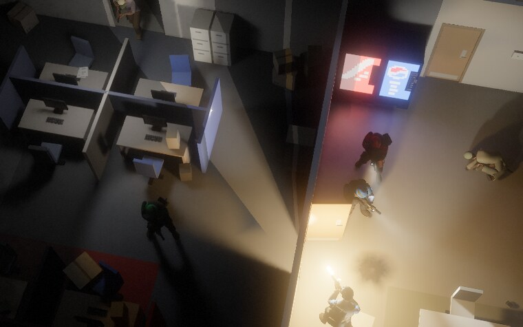
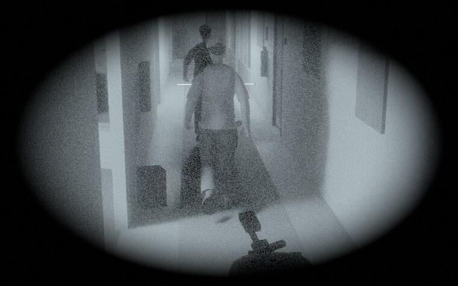
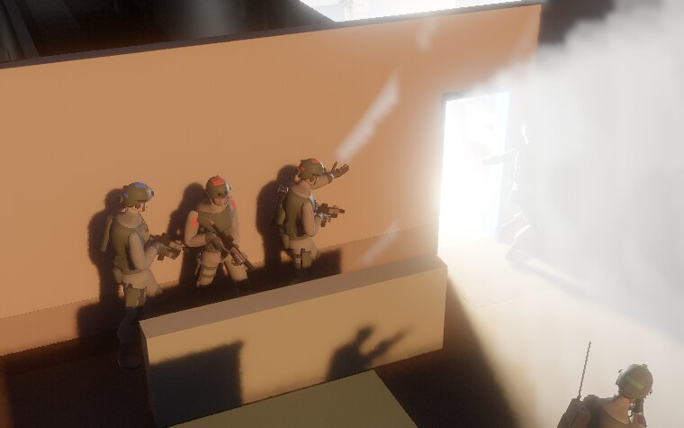
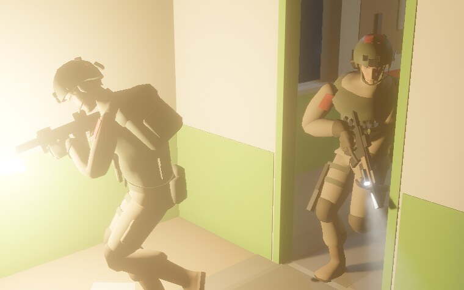
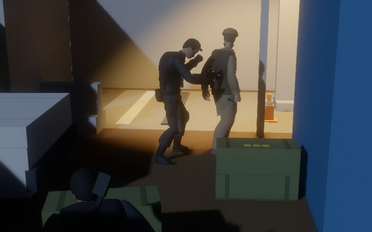

# The look

What twopointsix looks like today, as built, written down so new work can be held to it.
Where a rule has a number, the number is in the code and the file is named.

**Flat-coloured boxes under real light.** The world is plain shapes in plain paint. Everything fine
in the picture (soft shadow edges, colour bleeding off a wall, a beam hanging in dust, smoke rolling
under a lamp) comes from something physical going on, never from a painted surface.

The pictures in this file are mission-card key art: frames of the real game, taken closer and lower
than the camera you play from.

## The rules in short

1. **Boxes and flat colour.** Levels are boxes, one colour and one finish per box. No image textures, no gradients, no baked light or shadow.
2. **Light is the detail.** All light is computed live. If it glows it lights the room; if it lights the room you can point at where it comes from.
3. **Dark is the default.** A quiet night is mostly near-black with a few pools of light, each with a shape its source explains. A fight brings its own light: weapon lights, flashes, lit smoke.
4. **One model.** What the picture shows is what the men see and hear. Nothing is drawn that the simulation does not have, and the other way round.
5. **Made for the play camera.** A long lens, 21 m back and off to one side. Value reads from there, hue does not; shapes read, small print does not.
6. **Every place is a place.** A level is somewhere with a use; each room has a use you can name in two words and the furniture to prove it.
7. **Plausible kit and places.** 2010s gear, real door sizes, wear where use explains it. No insignia, no words to read.
8. **Show, don't tell.** Screens are few words, one accent, nothing that is not needed right now.

## Camera

- By default 55° down, turned 22° off the grid, 21 m back, a 28° lens (`src/game/camera.ts`). Nearly a plan view, but you see wall faces and men's shoulders. The player can zoom (6–40 m) and orbit.
- Rooms are drawn roofless: full-height walls are cut at the ceiling line and the cut is drawn as one near-black cap, like a section on a plan. There is no cut-away beyond that: you turn the camera instead.
- Things are sized and coloured to read from play distance. Key art and showcases go in closer and lower, and the models hold up there better than they were built to; the test for new work is still the play camera.

## Light

- The frame is `paint × (direct + bounced light) + what glows`. Direct light is ray traced from emitters that have a size, so shadows have real penumbras; bounce carries the colour of what it left.
- **Things that glow are lights.** A ceiling panel, a monitor, a server rack's LEDs, an exit sign: each lights its room and can be shot out. Panels and screens go with the mains; exit signs and rack LEDs stay.
- **Warm against cold.** Sodium lamps and tungsten bulbs outside and in back rooms; a cold moon and a navy sky. Office panels are near-white; the server room is blue with green LEDs.
- **The player's own light is the cold one.** Sam's rail light is cool white. Every other carried light is warm: guards' torches and teammates' weapon lights alike.
- **Alarm is red-orange.** In a blackout the emergency domes and spinning beacons come on; with the signs, the torches and the moon they are all the light left.
- **A flash has the colour of what makes it.** A muzzle flash is strongly orange and lasts 0.09 s; white there reads as a camera going off. A stun charge is hueless white and whites the room out for a frame; warm there reads as an explosion. Lightning is blue-white.
- **Light shows in the air** where a beam would: torches and beacons through haze, not ceiling panels or the moon.
- Night vision is a white-phosphor tube: one channel, heavy grain where the signal is weakest, an oval eyepiece.

Numbers: `levels/office.json` (`lights`, `switchables`), `src/game/rigProps.ts`, `src/game/effects.ts`, `src/game/hours.ts`.

## The grade

AgX tone mapping, a small bloom with no threshold (a fraction of every pixel scatters, as in a lens),
fine grain, light sharpening (`src/render/shaders/`, `post.wgsl` first). No colour filter, no lens
dirt, and no vignette except the red edge when you are hit: a clean photograph of a model, not a
treated one.

## Colour

Two palettes, one set of rules. Colours are linear albedo, written as plain numbers in code.

**The office** (`src/scene/officeGen.ts`): a neutral shell (pale walls, dark carpet, grey lino and
stone) with furniture in a few saturated primaries: brick-red and royal-blue partitions, tan desks,
blue chairs, cardboard brown.

**Everywhere else, the 2010s look** (`src/scene/gwotPalette.ts`): earth. Mud brick, lime render,
whitewash, concrete block; dust and dirt ground; poplar and grey wood; rust, iron, galvanised tin;
deep painted doors; red-brown rugs; olive and coyote kit.

Rules both palettes keep:

- **The plan reads before any colour does.** Full-height walls end in the dark cap, so a building reads as dark lines round lit floors; lower yard walls show their own tops, under a paler coping.
- **Earth ground is kept darker than the walls on it, on purpose.** Under a midday sun the exposure lifts every earth tone into one pale band; ground at a wall's value loses the plan and the men on it.
- **One accent per place.** One painted hue a level, on doors, a dado band and ground marks. A few places have none and are told by their floor instead.
- **Surfaces are quiet, things may be loud.** A wall carries colour only as a dado band; a floor only as marks. A partition, a door, a rug, a drum can be saturated.
- **A patch is darker than its ground, never paler**, and never under a third of it (that reads as a hole in the floor).
- No plain grey or white on anything that is not steel (the game reads paint: a blast takes a plain grey box for a steel cabinet), and no red-white-navy stripes on a rug (from above it is a flag).

## Surfaces

- **A finish per paint, not a texture.** Polished stone, lino and brushed metal are glossy; wood is satin; walls, carpet and earth are matte. The office's polished floors mirror the room where the quality tier traces reflections; the 2010s look keeps its ground matte.
- **Markings** are the one drawn thing: tiny palette bitmaps on a box face, on a 2.5 cm grid, at most three flat colours. They exist so an object reads as what it is: a vent's slats, a keypad, a crate's bands. Contrast reads at 21 m, hue does not, so they are bars and blocks. A door, a floor row or a range line may carry blocky digits or a letter; nothing spells a word.
- **Wear you can explain.** A darker path where people walk, grime at the skirting, bare metal on edges, damp at the foot of an outside wall, oil under an engine. Wear is the surface's own colour darker, and it also leads the eye to the doors.
- **Marks made in play** (bullet holes, scorch, scuffs, wet boot prints, cracked glass) change the surface the lights hit, so they catch light as the wall does.
- **Small things that matter are geometry.** Sheets on a desk are thin boxes, not a picture of paper on the desk.

Files: `src/scene/markings.ts`, `src/render/shaders/detail.wgsl`, `src/render/decals.ts`.

## Places

The building blocks are the same everywhere: 3 m ceilings, thick shell walls and thin partitions,
0.9 m doors, yard walls with a coping, and a kit of box-built objects (drums, sandbags, HESCO, cots,
stoves, crates, tyres, generators, pickups, lanterns). What makes a level is what it is *for*.

| Level | It is | Told by |
| --- | --- | --- |
| office | an office floor after hours | primary partitions, glass, glowing screens, gloss floors |
| compound | a farmer's walled house | mud and blue doors; the household on the ground, no painted lines |
| barracks | a police battalion's lines | whitewash and green; a volleyball court, tally bars at bunk doors |
| warehouse | a bonded customs shed | block walls, yellow-black hazard bands, lane lines, numbered doors |
| depot | an old army motor pool | cream over oxide red, oil stains, an inspection pit, lettered doors |
| registry | a provincial records office | floor tiles, dark varnish, a red and a blue line to follow; no accent |
| the block | a district telephone exchange | a green gloss dado, cable-trench cover plates through the rooms |
| records | a district land office | surveyors' magenta, on the ground only |
| consulate | a town-house consulate | plum carpet bound in brass |

Other levels have a skin of their own (`tools/levels/*-gwot.ts`) or are built straight from the kit
(`src/scene/gwotKit.ts`). No two places share an accent or a family of ground marks.

**A room** needs six things: a use named in two words; signature furniture big enough to read from
above; the clutter of that use; its own light; its own floor; something to shove or break. The
office is the yardstick: the manager's dark desk on red carpet, the conference table behind glass,
black racks in blue light, a storage room with one dim bulb. A room may be bare when that is its
use: the corridor has almost nothing in it.

## People

- One skeleton; a cast of part meshes, smooth bodies with hard-edged gear, no textures. Colour is per material slot (skin, eyes, two cloths, webbing, boots, helmet, metal, rubber, lens, one accent). Creases darken and ridges wear because the mesh has them.
- **Built for the top-down view.** The camera sees the crown of a head and the tops of shoulders, so men differ by silhouette there: headgear and what is on their back.
- **Sides read by value first.** On the 2010s levels operators are one mid-toned issue uniform (a camouflage pattern is drawn as its average colour) with dark green rigs and helmets; defenders wear muted local dress, pale or dark, never the ground's value, with no saturated colour.
- **Pairs read by colour.** On the 2010s levels the only bright colour on a man is his pair marking, a small red or blue panel on helmet and shoulders. In the office the older dress leans the whole suit toward the pair colour, and defenders are dressed for a building.
- **Quiet missions wear black.** Sam and a stealth partner go in a matt black suit, bare-headed, with a blacked-out rifle.

## Gear

Guns, goggles, canisters and tools are small sets of flat-coloured boxes bolted to bones
(`src/game/rigProps.ts`): gunmetal, dark-earth furniture, black polymer. They need to read as what
they are from play distance, no more. Canisters are told by a band (smoke red, stun pale, frag
yellow). What glows on gear: a lit weapon light's lens. The squad's lasers are infrared, hair-thin
lines seen only through night vision. Goggles never glow.

## Motion

- **Training shows in how a man carries himself.** Trained men glide: pelvis low, elbows in, gun steady. Untrained men swing their shoulders and wing an elbow.
- **Guns have weight, hands do the work.** A rifle takes longer to come round than a pistol. Kit is drawn, stowed and reloaded by hand; a door is pushed with a hand on it.

## Effects

- **A flash is a light first.** Muzzle flash, stun, a charge going off: each is a real light for its few frames, and the smoke starts on the same frame.
- **Smoke is one fluid** for the picture and for every eye in the game. It is lit by the room, takes beams through it, casts shadow, and softens what is behind it. Canister smoke is white; dust off a wall takes the wall's colour.
- **Sparks are hair-thin and over-bright**, cooling white to orange to red; the bloom is what makes them glow. Chips, dust, brass and paper are small lit things that land and stay.
- **Things break by material.** A wall wears, then holes; float glass falls in pieces, toughened glass dices whole, laminated glass webs and holds.
- **Tracers** are thin emissive streaks, slower than real ones on purpose, so they can be seen.
- **Weather and hour are light, not filters.** Night is the home hour: moon, lamps, storm. Dawn and dusk are a low orange sun; midday is hard short shadows and dark rooms by contrast; fog and dust are air that the same lights shine into.
- **Fog of war dims, it does not hide the building.** Floor nobody on the team can see stays drawn but dim and nearly grey; men there are not drawn, and doors and furniture stay as the team last saw them. Its edge is cut by walls and door frames, as on a plan.

Effect numbers are tuned by eye in the viewer and pasted back (`src/game/effects.ts`): treat them as authored data.

## Screens

The menus and the HUD are two different looks today.

**Menus** (`src/ui/theme.ts`) are a planning table: warm black `#0c0b09`, sand text `#d2c9b5`, and
one orange `#f0912e`. Headings are condensed bold caps; body is a plain sans, sentence case, short.
Flat fills and mostly square corners, no chrome.
Orange is spent sparingly, and each page has one filled block: the button that leads on. What does
not apply is not drawn. Missions are picture cards in groups, the way Door Kickers 2 lays its
missions out; the pictures are frames of the game being played. The man on the kit screen is lit by
rays, like the game.

**The HUD** (`index.html`) is after Splinter Cell: Chaos Theory: small monospace caps in green
(`#79d69a`, brighter `#8ff0b4`) on a faint dark backing, pushed to the edges. Kit and the LIGHT and SOUND bars sit bottom
left, orders top left, the objective top centre, radio bottom centre. Any colour but green means
something: gold, red and blue for who an order goes to; amber then red for alarm. In the world,
marks are single glyphs over a head (`?`, `!`, `zz`, `✕`) and speech is a small caption.

**Words.** Orders are lower-case verb phrases ("stack up", "fall in"); labels are caps; blurbs are
short and flat. Doors and rooms are named for what they are ("store door"), not by compass. If a screen needs a paragraph to
explain itself, the screen is wrong.

## Not the look

Each of these was tried or asked about and turned down; do not bring one back without a new reason.

- Image textures on surfaces, painted noise, gradients, baked shadows.
- Fake versions of physical things: dust motes that spawn in a torch cone, gun smoke as particles.
- Enemy laser sights; goggles that glow; a dollhouse wall cut-away.
- Player-facing switches for art constants. The look is decided here, not on a settings page.

## Holding new work to it

- Judge it from the play camera, in level lighting. Then crop small tiles around shadow edges and light pools and look again at 3–4×: "looks fine downscaled" has been wrong repeatedly.
- Ask where the detail comes from. If the answer is "it is painted on", it is not the look.
- Ask where the light comes from. If nothing in the room explains it, it is not the look.
- Ask what the men in the game make of it. If they cannot see what the player sees, fix the model, not the picture.
- A new place needs a use, an accent or a floor of its own, and rooms that pass the six.

Three things the code holds you to (`bun run tools/qa/probes.ts look`, `cast-look`):

- **The game reads paint.** Rounds, blasts and debris classify a box by its colour. A 2010s paint comes from `src/scene/gwotPalette.ts` and stands in for the office paint it replaced; do not invent colours on a level.
- **A skin changes paint only.** A level's 2010s file is the plain file box for box, plus flat decals that start at the floor.
- **Slot names are the contract with the meshes.** A character's material names are the slots above; a new mesh keeps them (`src/render/charMaterials.ts`).
